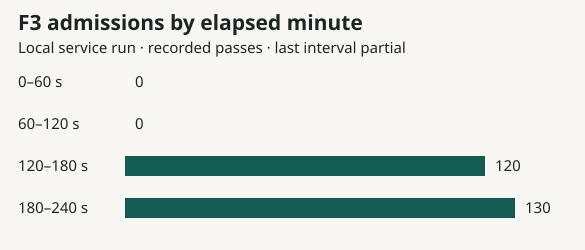
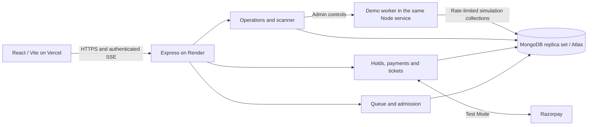
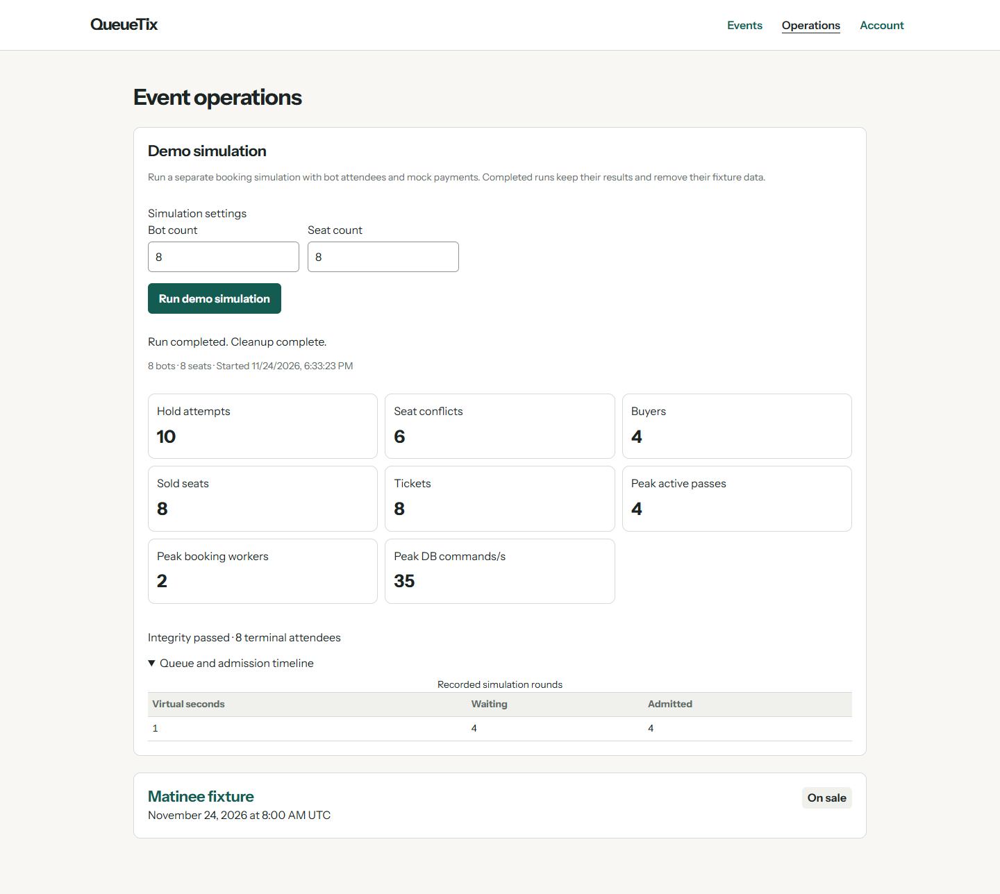

# QueueTix

QueueTix manages high-demand reserved-seat sales. Attendees enter a waiting room, receive a time-limited admission pass, choose seats and pay. Organizers publish cinema, bus and concert layouts and monitor their own sales. Assigned staff scan signed QR tickets at the door.

A service-level simulation of **5,000 users** and a separate **500-user HTTP and SSE run** passed locally. The HTTP run reached 100 open streams. The public deployment currently runs M4. [Live demo](https://queuetix.vercel.app/) · [Local M5 demo video](docs/evidence/admin-demo.mp4)

## How a sale works

At opening, the server freezes the lobby and orders its members by a seeded hash. Later arrivals join at the tail. The controller admits connected attendees in number order within the event's pass and stock limits. Reconnecting attendees recover their persisted position and deadlines.

Claims, quota changes and payment settlement use MongoDB transactions. A hold has a five-minute default. Only its owner can replace or release it. Successful settlement converts the recorded seats and issues one signed ticket per seat. Mock checkout and Razorpay Test Mode use the same booking rules. Razorpay fulfilment requires a verified captured payment for the expected order, amount and currency. Staff redemption checks the ticket's signature and event assignment, then atomically records first use.

The Operations dashboard shows queue length, active passes and holds, inventory, admissions over time and a server-side integrity check. Admins can run an isolated demo. [Architecture and recovery](docs/architecture.md)

## Measured local proof

The service-level simulation of **5,000 users** sold 500 seats to 250 buyers in 235.61 seconds. All 1,125 seat conflicts triggered a fresh selection attempt. The database held 500 distinct ticketed seats, and the integrity verifier passed.

A separate **500-user HTTP and SSE run** reached **100 concurrently open streams**. Five joins succeeded through the single loopback IP and 495 received the configured rate limit. A disconnected stream recovered its stored queue number. Hosted demo capacity remains unmeasured. [Measurements, terminal states, environment and reproduction commands](docs/load-test-report.md)

| Invariant                                                    | Local result                                             |
| ------------------------------------------------------------ | -------------------------------------------------------- |
| Every paid seat belongs to one order and has one ticket      | PASS across all five service fixtures                    |
| An oversubscribed seat can be held by one attendee           | PASS, one winner and 199 conflicts in T-HOLD-5           |
| Seeded queue order and active-pass cap hold under contention | PASS, zero order violations and a peak of ten passes     |
| Reconnecting clients recover authoritative state             | PASS, an HTTP stream restored its persisted queue number |

| Mode           | How to run                                                                           | What it exercises                                                                                             |
| -------------- | ------------------------------------------------------------------------------------ | ------------------------------------------------------------------------------------------------------------- |
| Local service  | `node scripts/simulate.js --mode service --users 5000 --seats 500 --concurrency 200` | Real queue, holds, mock payments, expiry and verification on a disposable replica set with a virtual clock    |
| Local HTTP/SSE | `node scripts/simulate.js --mode http`                                               | Authenticated HTTP, per-IP rate limiting, open streams, reconnect, booking and checkout over loopback         |
| Admin demo     | Open **Operations → Demo simulation** at `/operations/events`                        | A private fixture with 1–300 bots, 1–2,000 seats, a durable lock, measured progress, cancellation and cleanup |

## Local setup and demo

1. Use Node 22.12+ and npm. Run `npm ci` at the repository root.
2. For the interactive application, create local workspace environment files from [server/.env.example](server/.env.example) and [client/.env.example](client/.env.example) if absent. Set `MONGODB_URI` to a replica set you control and `CLIENT_ORIGIN` to the frontend origin. Generate separate random values of at least 32 characters for `JWT_SECRET`, `PAYMENT_WEBHOOK_SECRET` and `QR_HMAC_SECRET`. Keep private values on the server.
3. Set `VITE_API_URL` to the API origin. Google login uses matching server and Vite Google client IDs. Demo attendee login works without Google credentials. Leave `PAYMENT_PROVIDER=mock` for local checkout.
4. Run `npm run dev`. Open `http://localhost:5173` to browse published events or `/smoke` to inspect diagnostic results. An organizer can publish a fresh event and set its lobby and sale times. Join as an attendee, wait for admission, hold seats, pay and open **My tickets**.
5. For the local admin simulator, use a disposable single-member replica set on `127.0.0.1` with an explicit `replicaSet` URI parameter and a fresh database named `qt_proof_` followed by lowercase letters or digits. Sign in with an existing non-guest admin in that disposable database, open **Operations**, enter counts and choose **Run demo simulation**. Inspect the timeline, integrity and cleanup status. Admin and staff provisioning are trusted operator actions. The CLI proof commands provision their own databases automatically.

## Verification and deployment

Run `npm test`, `npm run lint`, `npm run format:check`, `npm run build` and `npm audit --omit=dev` from the root. Tests and local simulations create their own disposable MongoDB replica sets. First-time setup requires the pinned MongoDB binary. Simulations use mock payments regardless of the main application's provider.

Render builds from the repository root with `npm ci --omit=dev --workspace=server && npm run build --workspace=server` and starts with `npm run start --workspace=server`. Vercel uses the `client` root, workspace sources outside the root enabled, `npm ci --include=dev --workspace=@queuetix/client`, `npm run build --workspace=@queuetix/client` and the `dist` output. Set Render's `CLIENT_ORIGIN` to the stable Vercel origin and Vercel's `VITE_API_URL` to the Render origin. Check `/health/ready`, the cached Atlas transaction probe at `/health/db` and the browser at `/smoke`.

The deployed M4 release has owner-confirmed Test Mode checkout and purchasing. M5 has local evidence only. Actual webhook delivery, end-to-end refund reconciliation, physical camera and screen-reader checks remain open. The proposed M6 redesign and event image uploads are future work.

The free deployment can sleep between requests. MongoDB retains the sale and run records while in-process presence and SSE subscribers are rebuilt on wake. Scaling to multiple backend instances would require shared presence and SSE fan-out (for example, Redis), plus coordinated admission jobs and a shared command budget. Hosted throughput requires measurement on the deployed stack.
