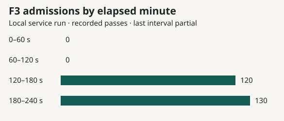

# QueueTix load-test report

Measured on 24 November 2026 on Windows, Node 22.14.0, Intel Core i7-1355U, with one fresh MongoMemoryReplSet 7.0.24 member per invocation. Each case is one observation on a development workstation. Some local QA overlapped the larger service runs. Timing is useful for reproducing this workload and has no hosted service-level guarantee. [Raw measurements and per-round timelines](evidence/benchmarks.json)

## A. Service-level contention

| Fixture | Profile  | Terminal users | Sold | Buyers | Tickets | Hold attempts | Conflicts and retries | Wall seconds |
| ------- | -------- | -------------: | ---: | -----: | ------: | ------------: | --------------------: | -----------: |
| F1      | greedy-2 |            200 |   40 |     20 |      40 |           110 |                    90 |         9.81 |
| F1B     | mixed    |            200 |   40 |     20 |      40 |           144 |                   120 |        14.92 |
| F2      | greedy-2 |           2000 |  500 |    250 |     500 |          1375 |                  1125 |       134.17 |
| F2B     | mixed    |           2000 |  500 |    250 |     500 |          1968 |                  1610 |       179.50 |
| F3      | greedy-2 |           5000 |  500 |    250 |     500 |          1375 |                  1125 |       235.61 |

All five runs passed the event integrity verifier. Each sold seat had one distinct ticket, and paid-order seat counts matched inventory. All five reached ten active passes at peak and recorded zero ordering violations. The isolated T-HOLD-5 regression separately sent 200 concurrent holds for one seat. Exactly one succeeded and the other 199 received `SEAT_UNAVAILABLE`.

The small show has four rows of ten. The owner approved moving the aisle after seat four on 24 November. Splitting a row into two blocks of five leaves two singles even with perfect pair allocation. Blocks of four and six make the required 20 adjacent-pair purchases possible. The big show has 25 rows of 20, with an aisle after seat ten. F3 uses the same layout.

Each attendee enters through the queue service. The seed fixes fixture identities and the frozen lobby ranking. The runner compares persisted numbers against the independent SHA-256 ranking and observes committed admissions in order. Each wave takes current best-available proposals before submitting the holds. A losing bot asks for a fresh proposal, including when all the inventory has just sold. MongoDB determines the race winner. The mixed profile assigns abandonment to two of ten hash buckets, failed payment to one and successful payment to seven. The configured probabilities apply to attendees who obtain a hold.

F1b recorded three abandoned holds, three hold expiries and one failed payment. Its terminal counts were 20 completed, four expired and 176 expired after sellout. F2b recorded 60 abandoned holds and 48 failed payments. Its terminal counts were 250 completed, 115 expired and 1,635 expired after sellout. Greedy F1, F2 and F3 ended with 180, 1,750 and 4,750 `expired_soldout` entries respectively.

The simulation clock jumps through expiry between rounds and refreshes waiting attendees' presence. Wall time uses a monotonic clock and includes fixture setup, joins, booking, verification and scoped cleanup. Replica startup and shutdown are outside that interval. Configured concurrency was 20 for F1/F1b and 200 for F2/F2b/F3. The real queue serializes joins on its event row, and the admission controller caps booking participation. These figures count in-process service users.

## B. HTTP and incremental SSE

One Express listener on loopback served **500 authenticated fixture users**, with request concurrency 16 and **100 simultaneously open queue streams** measured after initial SSE frames. All 500 completed their HTTP scenario. Five joined from the single client IP and 495 received the expected HTTP 429 with `Retry-After`. No forwarding headers were supplied. Responses comprised 640 HTTP 200 and 495 HTTP 429. One stream disconnected deliberately and reconnected with a fresh snapshot matching persisted queue number 3. There were zero unexpected connection failures or server errors.

The five admitted users bought all ten seats. Six hold requests included one failed mock payment followed by a successful retry. The verifier found no issues. Wall time was 18.50 seconds, including the HTTP fixture and requests through verification. Teardown closed readers, sockets, the server and the disposable database. HTTP timings use the real clock. Join latency includes rate-limited replies. Only six hold samples contribute to the HTTP hold percentiles.

## End-to-end operation latency

Milliseconds, nearest-rank percentiles. Service join timing includes time spent waiting for the event's serialized join transaction. Hold timing includes genuine seat conflicts.

| Run  | Join p50 | Join p95 | Hold p50 | Hold p95 |
| ---- | -------: | -------: | -------: | -------: |
| F1   |   216.65 |   415.15 |   121.52 |   451.92 |
| F1B  |   329.66 |      627 |   224.58 |   312.32 |
| F2   |  2396.13 |  5072.92 |    181.2 |   293.66 |
| F2B  |  2273.85 |  4990.91 |   196.62 |   357.45 |
| F3   |  2609.16 |   5671.3 |   201.87 |   348.82 |
| HTTP |   127.63 |   195.86 |     72.9 |    115.7 |



The first two minutes of F3 were spent preparing and joining the lobby. The final interval is partial. Per-wave records in the JSON include both elapsed wall time and virtual seconds. Regenerate the chart with `node scripts/proof/chart.js`.

## C. Admin demo

Administrators launch the demo from Operations. Its dedicated worker uses the same queue, booking and integrity services with isolated collections, mock-only payments, a durable run lease and a paced MongoDB connection. The operator can inspect progress and cancel.

A local worker run before the lease-recovery follow-up processed 300 bots, sold 40 seats to 20 buyers and issued 40 tickets in 110.13 seconds. It recorded 3,540 monitored commands, a peak of 35 per rolling second, two simultaneous booking workers and completed cleanup with a clean integrity result. This measurement came from a disposable loopback replica set. Hosted execution and sustainable Render/Atlas capacity remain **NOT RUN**.

## Reproduce

From the repository root after `npm ci`, run the following commands individually. Each starts a new loopback replica set and supplies its own credentials. No application environment file or external database URI is needed. On first use the MongoDB binary must be available for download or via `MONGOMS_SYSTEM_BINARY`.

```sh
node scripts/simulate.js --mode service --fixture small-show
node scripts/simulate.js --mode service --fixture small-show --profile mixed
node scripts/simulate.js --mode service --fixture big-show --concurrency 200
node scripts/simulate.js --mode service --fixture big-show --profile mixed --concurrency 200
node scripts/simulate.js --mode service --users 5000 --seats 500 --concurrency 200
node scripts/simulate.js --mode http --users 500 --seats 10 --streams 100 --concurrency 16
npm test -w server -- --runTestsByPath test/m2.test.js -t T-HOLD-5
```

All measured local fixtures used seed `queue-proof`. Set `--seed` to repeat a different scenario. Add `--output path/to/new.json` to retain a fresh result in an existing directory. The CLI exits unsuccessfully on an assertion failure and refuses to replace an existing report.
